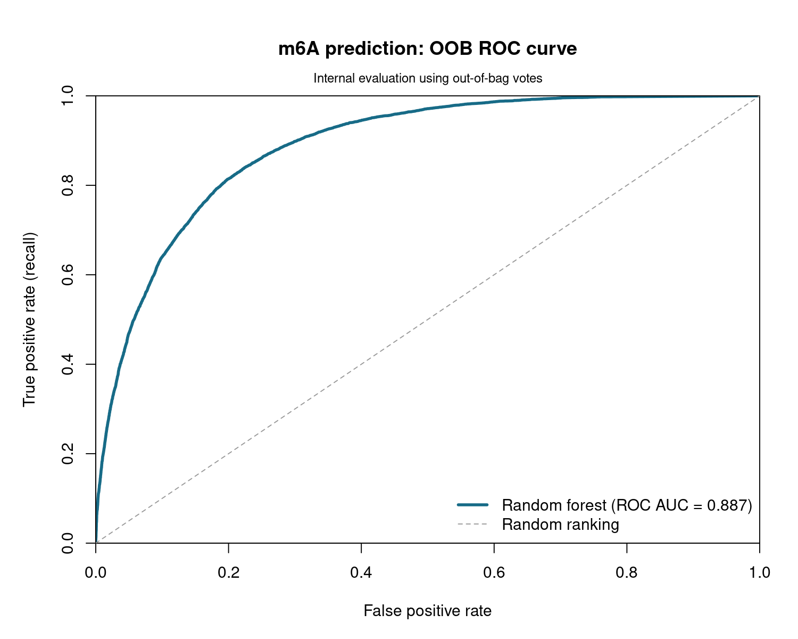
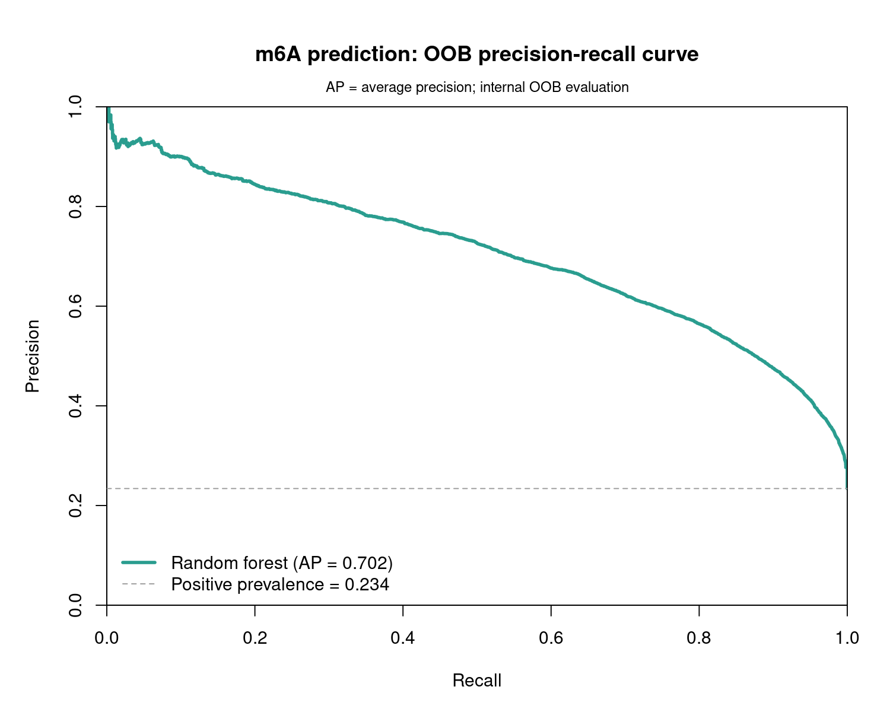

# m6APrediction

An R package for predicting RNA N6-methyladenosine (m6A) site
probabilities and classification statuses using a pretrained random
forest model.

The package combines local sequence context with transcript annotations,
structural features, and evolutionary conservation. It supports batch
prediction from a feature table and prediction for a single candidate
site.

Developed for BIO215 Practical 6 and Practical 7.

## Installation

Install the package from its public GitHub repository:

```r
install.packages("remotes")
remotes::install_github("zixiao613-cloud/m6APrediction")
```

Load the package:

```r
library(m6APrediction)
```

The package declares R >= 3.5.0 and depends on randomForest and stats.
Development and package checks were performed with R 4.5.1 on the
teaching server. Dependencies may require a more recent R version
than the declared minimum.

## Input features

Both prediction functions use the following seven features.

| Feature | Expected input |
|---|---|
| `gc_content` | Numeric GC content between 0 and 1 |
| `RNA_type` | `mRNA`, `lincRNA`, `lncRNA`, or `pseudogene` |
| `RNA_region` | `CDS`, `intron`, `3'UTR`, or `5'UTR` |
| `exon_length` | Exon-length feature on the log2 scale used in the course dataset |
| `distance_to_junction` | Junction-distance feature on the log2 scale used in the course dataset |
| `evolutionary_conservation` | Numeric conservation score between 0 and 1 |
| `DNA_5mer` | Five uppercase DNA bases using A, T, C, and G |

The supplied model was trained on sequence contexts with A at the
central position. Input tables must contain all seven columns and
have no missing feature values.

The length and distance features must use the same preprocessing
as the training data. Raw lengths or distances should not be
substituted for the supplied log2-scale features.

## Batch prediction

This example loads the bundled model and example data, then predicts
the first three sites.

```r
library(m6APrediction)

ml_fit <- readRDS(system.file(
  "extdata", "rf_fit.rds",
  package = "m6APrediction", mustWork = TRUE
))

example_df <- read.csv(system.file(
  "extdata", "m6A_input_example.csv",
  package = "m6APrediction", mustWork = TRUE
))

results <- prediction_multiple(
  ml_fit = ml_fit,
  feature_df = example_df[1:3, ],
  positive_threshold = 0.6
)

results[, c("predicted_m6A_prob", "predicted_m6A_status")]
```

Expected output with the bundled model and example data:

```text
  predicted_m6A_prob predicted_m6A_status
1             0.876             Positive
2             0.000             Negative
3             0.498             Negative
```

The returned data frame contains the input features and two additional
columns:

- `predicted_m6A_prob`: numeric positive-class probability.
- `predicted_m6A_status`: `"Positive"` or `"Negative"`.

The RNA category columns are converted to factors with the levels
used during model training.

## Single-site prediction

This example is self-contained and loads its own model.

```r
library(m6APrediction)

ml_fit <- readRDS(system.file(
  "extdata", "rf_fit.rds",
  package = "m6APrediction", mustWork = TRUE
))

single_result <- prediction_single(
  ml_fit = ml_fit,
  gc_content = 0.6,
  RNA_type = "mRNA",
  RNA_region = "CDS",
  exon_length = 12,
  distance_to_junction = 5,
  evolutionary_conservation = 0.8,
  DNA_5mer = "GGACA",
  positive_threshold = 0.5
)

single_result
```

Expected output:

```text
predicted_m6A_prob predicted_m6A_status
           "0.51"           "Positive"
```

The function returns a named character vector of length two.
To use the probability in calculations:

```r
as.numeric(single_result["predicted_m6A_prob"])
```

## Interpreting predictions

The positive-class probability is the proportion of random forest
votes for the Positive class.

A site is classified as Positive only when its probability is
strictly greater than `positive_threshold`. A score equal to the
threshold is classified as Negative.

Changing the threshold changes the classification decision while
the model's probability score stays the same.

These predictions describe patterns learned from the course data.
They require appropriate experimental validation before biological
conclusions can be drawn.

## Included resources

- `rf_fit.rds`: the fitted random forest model supplied with
  the Practical 6 materials.
- `m6A_input_example.csv`: 100 example observations with seven
  input features.

The example data demonstrate package use and reproducible outputs.
They are not an independent test set for assessing predictive accuracy.

## Documentation and software checks

Open the function help pages with:

```r
?prediction_multiple
?prediction_single
```

The package passed the following development check on the teaching
server with **0 errors, 0 warnings, and 0 notes**:

```r
devtools::check(args = "--no-manual", cran = FALSE)
```

The two exported prediction functions' documentation examples also
ran successfully. These checks establish software functionality;
independent predictive performance requires separate evaluation.

## License

MIT. See LICENSE and LICENSE.md.

## Contact

Zixiao Feng  
Zixiao.Feng24@student.xjtlu.edu.cn

<!-- OOB-EVALUATION -->
## Model performance: internal OOB evaluation

Evaluation includes 48055 observations, with 11248 Positive and 36807 Negative labels.

Each observation is scored using votes from trees whose bootstrap
training samples excluded that observation. These are out-of-bag
(OOB) predictions from the bundled model.

- ROC AUC: **0.8873**.
- Average precision (AP): **0.7022**.
- Positive-class prevalence: **0.2341**.





ROC AUC summarizes discrimination across thresholds. Average
precision summarizes precision weighted by increases in recall.
The dashed PR reference line indicates positive-class prevalence.
Distinct score thresholds are evaluated with tied scores grouped.

These results provide internal performance estimates. External
generalization requires evaluation on independent data.
The 100-row example CSV is used only for usage demonstrations.

